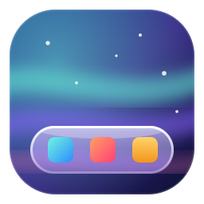
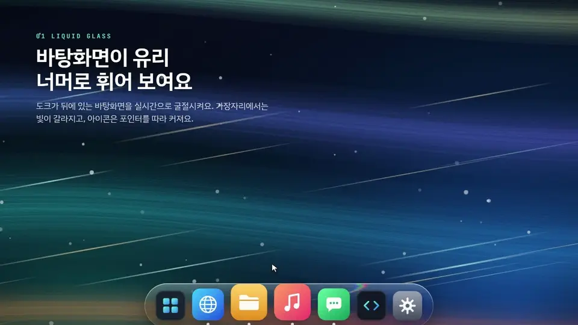
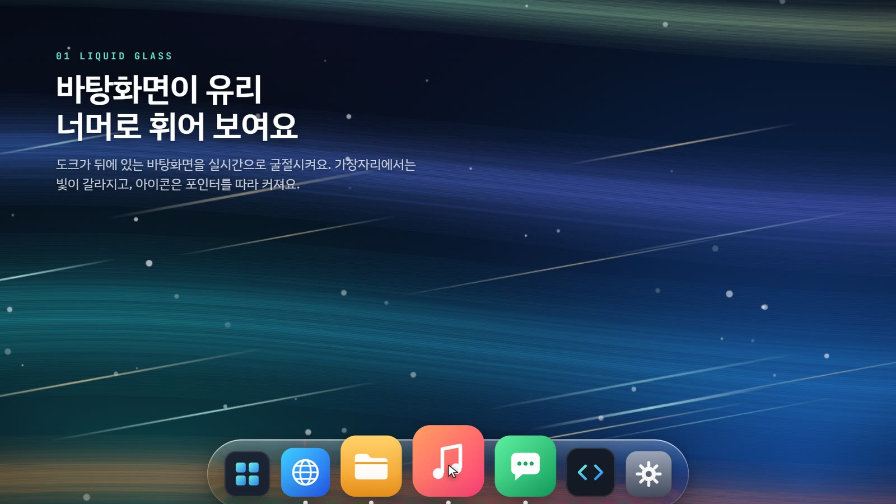
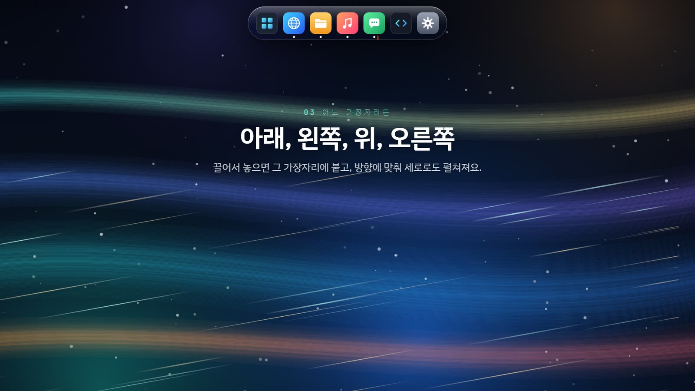
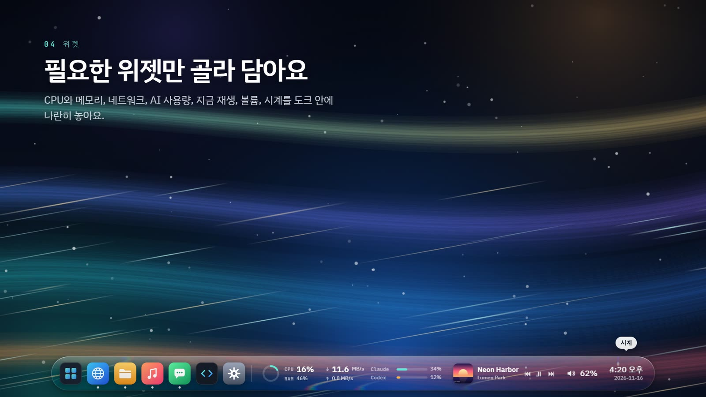
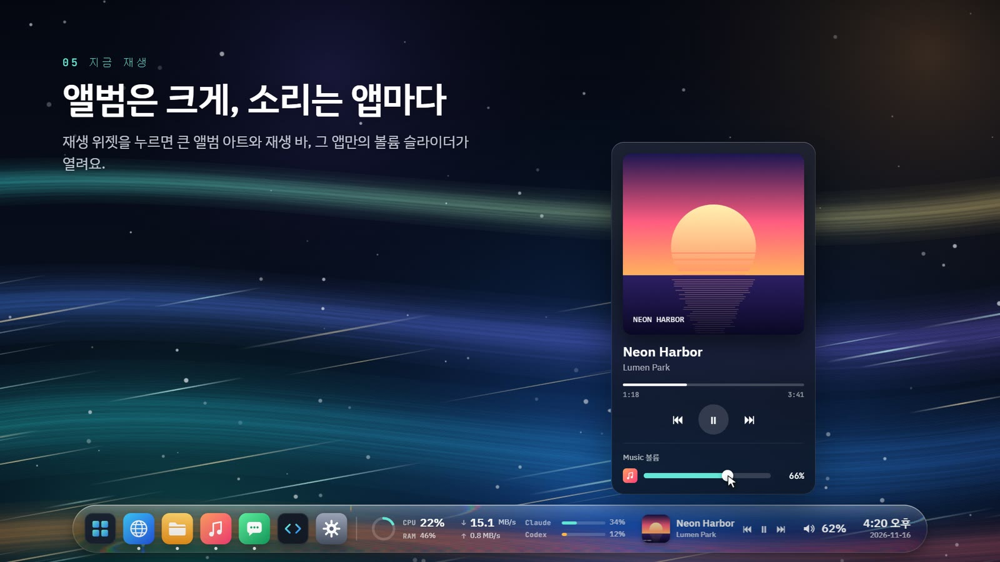

https://github.com/user-attachments/assets/2e255bcc-6a10-4909-8ead-7a4ef4696b26

<h1 align="center">GlassDock</h1>

Windows 11 작업 표시줄을, 유리로.

  <a href="https://github.com/Mojjiman/GlassDock/releases/latest"><b>⬇ 다운로드 (최신 버전)</b></a>

▶ 그림을 누르면 1분 2초짜리 전체 소개 영상(1080p 60fps, 소리 포함)이 열려요.

https://github.com/user-attachments/assets/ae9ba084-0107-4e61-8cb3-32cbeecd137f

GlassDock은 Windows 11의 작업 표시줄을 숨기고, 그 자리에 뒤 배경이 유리처럼 비치는 도크를 띄우는 프로그램이에요.

## 기능

**Liquid Glass**: 도크가 뒤의 바탕화면을 실시간으로 굴절시키고, 가장자리에서는 빛이 갈라져요. 창이 도크 뒤로 오면 흐린 유리로 바뀌었다가 창이 비키면 다시 돌아와요.

**자동 숨기기**: 안 쓸 때는 화면 밖으로 숨어 있다가, 포인터를 가장자리에 대거나 Win 키를 누르면 올라와요.

**어느 가장자리든**: 아래, 왼쪽, 위, 오른쪽 어디에나 붙일 수 있고, 세로로 붙이면 방향에 맞춰 세로로 펼쳐져요.

**위젯**: CPU·메모리, 네트워크, AI 사용량(Claude·Codex), 지금 재생, 볼륨, 시계 같은 위젯을 도크 안에 원하는 대로 넣어요.

**지금 재생**: 재생 위젯을 누르면 큰 앨범 아트, 재생 바, 그 앱만의 볼륨 슬라이더가 열려요.

그 밖에 앱 묶음(폴더처럼 여러 앱을 한 칸에), 폴더 스택, 아이콘 확대, Win+1~0 단축키, 알림 배지, 최대화한 창 아래를 채우는 유리 띠도 있어요.

## 설치

1. [Releases](https://github.com/Mojjiman/GlassDock/releases/latest)에서 `GlassDock-<버전>-win-x64.zip`을 받아요.
2. 원하는 폴더에 압축을 풀고 `GlassDock.exe`를 실행해요. .NET 같은 걸 따로 설치할 필요는 없어요.
3. **"Windows의 PC 보호"** 창이 뜨면 **[추가 정보] → [실행]**을 눌러요. 코드 서명이 없는 개인 프로그램이라 처음에 한 번 나오는 경고예요.

- **필요한 것:** Windows 11 (64비트)
- **설정 위치:** `%APPDATA%\GlassDock`
- **사용법·끄기·지우기:** zip 안의 `README.txt`에 자세히 적어 뒀어요.

## 끄기와 문제 해결

- **끄기:** 도크 빈 곳을 오른쪽 클릭 → [GlassDock 설정] → 맨 아래 [GlassDock 종료]를 누르면 원래 작업 표시줄이 돌아와요.
- **작업 표시줄이 안 돌아올 때:** 보통은 자동으로 복구돼요. 그래도 안 되면 GlassDock이 있는 폴더에서 `GlassDock.exe --restore-taskbar`를 실행하거나, 로그아웃했다가 다시 로그인해요.

---

이 저장소는 배포용이라 실행 파일과 소개 자료만 올려요.
